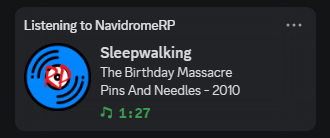

# NavidromeRP

#### *Discord rich presence for [Navidrome](https://www.navidrome.org/)*



## Usage

### Install/Setup
```bash
$ git clone https://github.com/TriFoxie/NavidromeRP
$ cd NavidromeRP
$ python NavidromeRP.py
```
Alternatively, download the [latest release](https://github.com/TriFoxie/NavidromeRP/releases/latest) and run `Navidrome.py`

### Run as a process
Once setup has been completed, you use `Navidrome.pyw` instead to run it as a background process.

### Dependencies
- Python
- Pip
  - pypresence
  - requests
```bash
$ pip install pypresence requests
```

## Docs
- [pyPresence](https://qwertyquerty.github.io/pypresence/html/index.html)
- [Discord rich presence](https://discord.com/developers/docs/rich-presence/overview)
- [Navidrome REST api](https://www.navidrome.org/docs/developers/subsonic-api/) (getNowPlaying)

---


